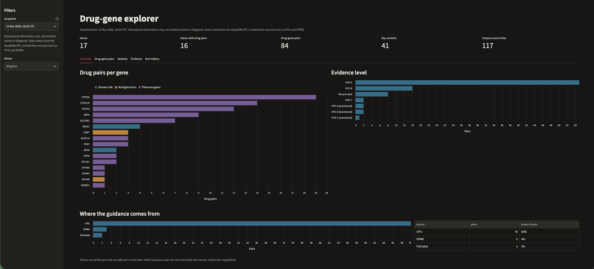
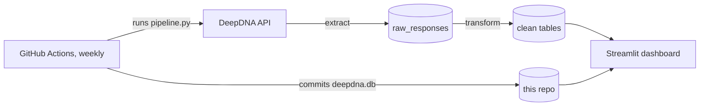

# DeepDNA drug-gene explorer

A data pipeline and dashboard for pharmacogenomics reference data. It pulls genes, drug-gene pairs, variants, and their citations from the free [DeepDNA API](https://deepdna.ai/docs/), stores each pull as a timestamped snapshot in SQLite, refreshes itself weekly with GitHub Actions, and serves an interactive Streamlit dashboard.

[](https://github.com/kenjoves/deepdna-drug-gene-pipeline/actions/workflows/weekly-refresh.yml)

**[Live dashboard](https://deepdna-kj.streamlit.app/)**



> Educational information only. Nothing here is medical advice, diagnosis, or dosing guidance.

## The question

Which genes affect the most medications, and how strong is the evidence behind each drug-gene pair?

## What the data shows

Numbers from the 15 November 2026 snapshot. The dashboard always shows the latest run.

- **Coverage:** the API lists 17 genes. 16 have curated drug pairs, 84 pairs in total. HFE is listed but has no curated pairs yet.
- **Concentration:** CYP2D6 (19 pairs), CYP2C19 (14), and CYP2C9 (12) account for 45 of the 84 pairs, about 54%.
- **Evidence:** 70 pairs (83%) rest on a CPIC guideline, 3 on DPWG, and 2 mention FDA labeling. 55 pairs (65%) carry the strongest CPIC level, A. Shares use all 84 pairs and overlap, because a pair can cite several sources.
- **Multi-gene drugs:** 10 drugs depend on more than one gene. Warfarin depends on three (CYP2C9, CYP4F2, VKORC1). The thiopurines (azathioprine, mercaptopurine, thioguanine) depend on both TPMT and NUDT15.
- **Variants:** 41 key variants across the 17 genes, each with alleles, functional effect, frequency note, and sources.
- **Citations:** 346 citations on drug-gene pairs. PubMed (114), CPIC (77), PharmGKB (72), and PharmVar (44) are the most cited websites.
- **Phenotypes:** 373 phenotype rows across 82 pairs, typically 3 to 6 groups per pair. Poor, intermediate, and normal metabolizer are the most common codes (51 rows each).

## How it works



1. **Extract.** `pipeline.py` asks the API which genes it has, then pulls drug-gene pairs, gene details, and variants. Every raw JSON response is saved first.
2. **Transform.** Raw responses are flattened into clean tables. Changing a field mapping never requires calling the API again.
3. **Check.** After each run it compares against the previous run and warns if genes, pairs, or variants dropped, or if every variant is missing its effect.
4. **Snapshot.** Each run is stamped, so the dashboard can show any past snapshot and a run history.

### Data model

| Table | One row per |
|---|---|
| `drug_gene_pairs` | gene and drug, with guideline, evidence level, and summary |
| `phenotypes` | phenotype group of a pair, split into name, code, and description |
| `pair_sources` | citation supporting a pair |
| `variants` | gene and variant (rsID), with alleles, effect, and frequency note |
| `variant_sources` | citation supporting a variant |
| `run_summary` | pipeline run, with counts for genes, pairs, and variants |
| `raw_responses` | raw API response (kept for the newest runs only) |

## Run it yourself

```bash
git clone https://github.com/YOUR-USERNAME/YOUR-REPO.git
cd YOUR-REPO

python -m venv .venv
source .venv/bin/activate          # Windows: .venv\Scripts\activate
pip install -r requirements.txt -r requirements-pipeline.txt

python pipeline.py run             # pull data into deepdna.db
streamlit run app.py               # open the dashboard
```

### Pipeline commands

| Command | What it does |
|---|---|
| `python pipeline.py run` | Pull everything and run quality checks |
| `python pipeline.py run --genes CYP2D6,DPYD` | Pull only these genes |
| `python pipeline.py run --skip-variants` | Drug-gene pairs only |
| `python pipeline.py run --strict` | Exit with code 2 if a quality check warns |
| `python pipeline.py summary` | Show the run history |
| `python pipeline.py inspect genes` | Print a raw API response (also `gene`, `variant`, `pgx`) |
| `python pipeline.py reprocess` | Rebuild tables from stored raw data, with no API calls |
| `python pipeline.py prune --keep 52 --keep-raw 2` | Keep 52 runs, and raw API data for the newest 2 |

Exit codes: `0` ok, `1` the run failed, `2` finished with warnings (only with `--strict`).

The exploratory analysis that led to this code is in [`notebooks/`](notebooks/).

## Automatic weekly refresh

[`.github/workflows/weekly-refresh.yml`](.github/workflows/weekly-refresh.yml) runs every Monday at 06:00 UTC, and on demand from the Actions tab. It runs the pipeline, trims old runs, and commits the updated `deepdna.db`. A run that fails stops the workflow. A run that finishes with quality warnings is still saved, with a warning annotation on the workflow run.

Setup:

1. Commit your local `deepdna.db` first so the run history carries over. Otherwise the first workflow run starts a new database.
2. If the workflow can't push, open Settings, then Actions, then General, and set workflow permissions to read and write.
3. Start a first run from the Actions tab to confirm it works.
4. GitHub pauses scheduled workflows in public repositories after 60 days without repository activity. If that happens, re-enable the workflow from the Actions tab.

The workflow keeps the newest 52 runs and the raw API responses for only the newest 2. The clean tables are small, so the database stays compact while the history stays complete.

## Deploy the dashboard

1. Go to [share.streamlit.io](https://share.streamlit.io) and choose **New app**.
2. Select this repository, the `main` branch, and `app.py` as the main file.
3. Streamlit installs `requirements.txt` automatically. Each weekly data commit updates the app.

## Design decisions

- **Raw first.** Storing every raw response means a wrong field name costs one `reprocess` command, not a re-pull.
- **Snapshots, not overwrites.** Every run is kept, so coverage over time is a query.
- **Robust parsing.** Variant IDs are found by pattern in each gene's response, so the pipeline doesn't depend on one field name. Lists, objects, and nulls are all handled.
- **Safe failures.** A failed run removes its own partial data. `reprocess` skips runs whose raw data was pruned, so it can't wipe their tables.
- **Honest denominators.** Evidence shares in the dashboard divide by all pairs and note that they overlap.

## Limitations

- The data is curated reference data with a small gene set, and it changes slowly. Expect flat lines in the run history until the API adds coverage.
- Phenotype codes are parsed from text like `Poor metabolizer (PM): ...`. Some genes (G6PD, SLCO1B1, and others) describe phenotypes differently, so about 38% of phenotype rows have no metabolizer code. Genotype and activity-score labels also appear in the `code` column.
- A variant's functional effect is free text, so it can't be counted by category without more cleaning.
- The pipeline pauses between API calls and the dashboard is read-only. Check the [API terms](https://deepdna.ai/terms/) before changing the schedule.

## Data source and disclaimer

Data comes from the DeepDNA API, which curates it from sources including CPIC, DPWG, PharmGKB, PharmVar, ClinVar, OMIM, and dbSNP. This project is independent and is not affiliated with DeepDNA. Every record links back to its sources. This is a learning project: do not use it to make decisions about medication, and talk to a clinician or pharmacist about any health question.

## Project structure

```
.
├── app.py                          Streamlit dashboard
├── pipeline.py                     extract, transform, quality checks, CLI
├── deepdna.db                      SQLite database (updated weekly)
├── requirements.txt                dashboard dependencies
├── requirements-pipeline.txt       pipeline dependencies
├── .streamlit/config.toml          dashboard theme
├── .github/workflows/
│   └── weekly-refresh.yml          scheduled data refresh
└── notebooks/                      exploratory analysis
```

## Roadmap

- Split the free-text variant effect into categories (loss of function, reduced function, increased function)
- Improve the phenotype parser for genes that use genotypes or activity scores
- Add a "what changed since last run" view to the dashboard
